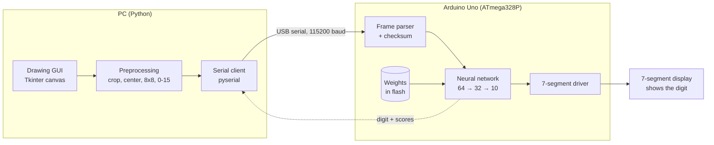
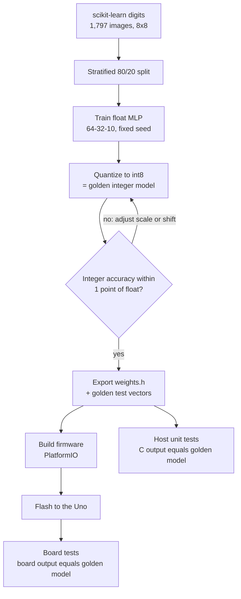
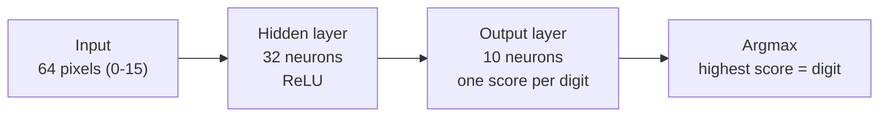
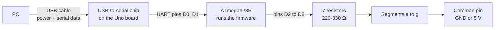
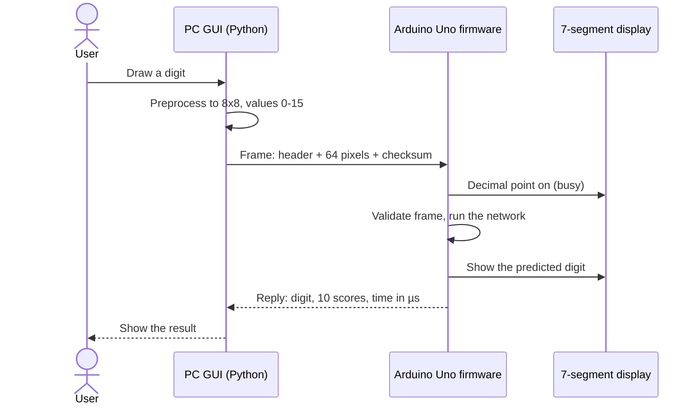
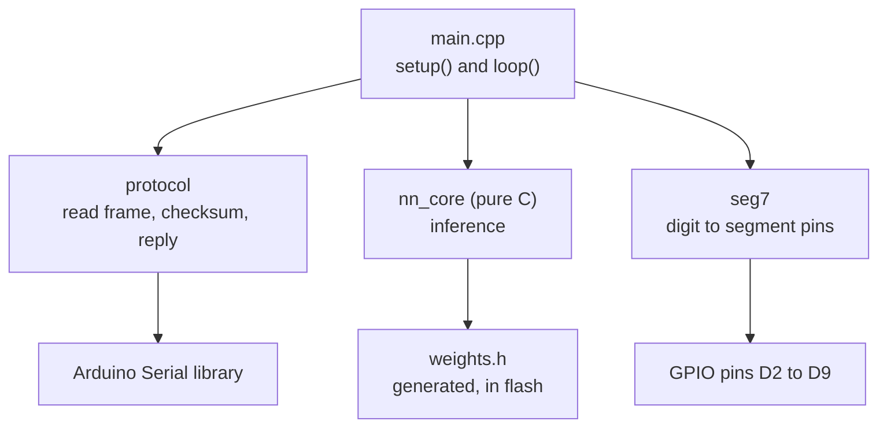
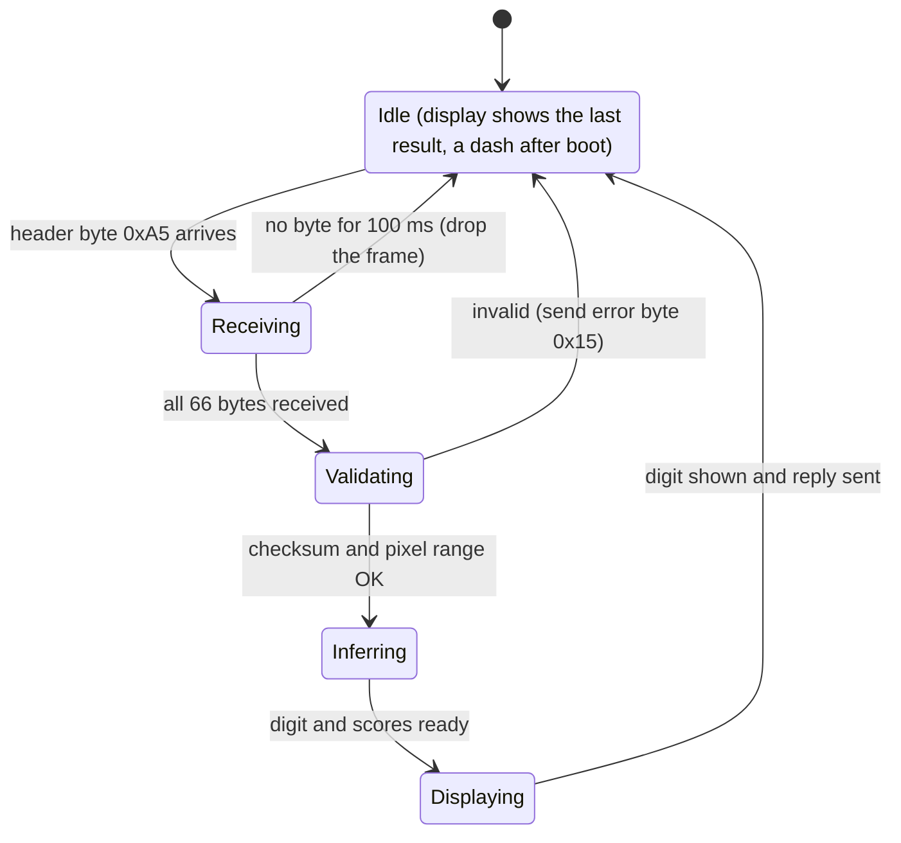

# MNIST Digit Recognition on Arduino Uno

Draw a digit on your PC. An Arduino Uno runs a small neural network on the board and shows the answer on a 7-segment display.

**Status:** design phase &nbsp;·&nbsp; **Board:** Arduino Uno R3 (ATmega328P) &nbsp;·&nbsp; **Languages:** C/C++ (firmware), Python (PC tools and training)

**Contents:** [About](#about) · [System Design](#system-design) · [Firmware Design](#firmware-design)
testing

---
## How to clone

### HTTPS Method
```
git clone https://github.com/PJ-Caleon/MNIST-Neural-Network-Uno.git
cd MNIST-Neural-Network-Uno/
```

### SSH
```
git git@github.com:PJ-Caleon/MNIST-Neural-Network-Uno.git
cd MNIST-Neural-Network-Uno/
```

## Naming Branch Rule

Each issue must create a new branch 

To create a branch, first always `git pull` then
```
git switch -c <branch-name>
```
The branch name format will be like `p2-23` which means phase 2 - issue 23 

So as an example:
```
git switch -c p2-23
```

## How to Make a PR
```
git add .
git commit -m "something"
git push -u origin <branch-name>
```

Then go to github to make a pull request. In the pull request, in the description add
```
closes #<issue number>
```

to tell what PR this issue closes
## About

### Overview

This project is inspired by a working MNIST digit recognizer on an FPGA (Digilent Nexys 3), shared in [this r/embedded post](https://www.reddit.com/r/embedded/s/Mp8CEvFhrD). The FPGA reference implementation is [Si7li/MNIST-Neural-Network-On-FPGA](https://github.com/Si7li/MNIST-Neural-Network-On-FPGA).

This is a personal project to upskill and to have fun with embedded machine learning. It replaces the FPGA with an Arduino Uno. The objective is to replicate the FPGA's accuracy while doing all the neural network computation on the board. The PC only draws the digit and sends it.

A second project, [yair-byte/ultra-fast-classification-of-MNIST-digits-on-Arduino-UNO](https://github.com/yair-byte/ultra-fast-classification-of-MNIST-digits-on-Arduino-UNO), already runs MNIST on an Uno. It uses a binary neural network and is the **benchmark** for this repo.

### Reference points

| | FPGA reference | Arduino benchmark | This project (target) |
|---|---|---|---|
| Hardware | Nexys 3 (Spartan-6 FPGA) | Arduino Uno | Arduino Uno |
| Model | MLP 64 → 32 → 10, 8-bit weights | Binary neural network, 24×24 binarized input | MLP 64 → 32 → 10, 8-bit weights |
| Dataset | scikit-learn digits (8×8 pixels) | MNIST (downscaled to 24×24) | scikit-learn digits (8×8 pixels) |
| Accuracy | 97.5% (360 test images) | 88.72% (MNIST test set) | Match the FPGA |
| Time per digit | ≈ 8 µs | ≈ 20 ms | Estimate 5–15 ms (to be measured) |
| Flash | Not applicable (FPGA logic) | 8,540 B (26%) | ≈ 3 KB for weights + core, plus the Arduino core (to be measured) |
| SRAM | Not applicable | 1,778 B (86%) | Estimate < 0.5 KB (to be measured) |

> [!NOTE]
> The two references use **different datasets**, so their accuracy numbers cannot be compared directly. This project reports accuracy on the FPGA's dataset first. A like-for-like comparison with the Arduino benchmark needs a model trained and tested on MNIST. That is planned as a stretch goal (see [Evaluation protocol](#38-evaluation-protocol)).

### References

- [FPGA reference implementation (Si7li)](https://github.com/Si7li/MNIST-Neural-Network-On-FPGA)
- [r/embedded post that inspired the project](https://www.reddit.com/r/embedded/s/Mp8CEvFhrD)
- [Arduino Uno binary-network benchmark (yair-byte)](https://github.com/yair-byte/ultra-fast-classification-of-MNIST-digits-on-Arduino-UNO)

Both references are credited. This repo is an independent implementation of the idea.

---

## System Design

### 1. Architecture overview



**Data path, step by step**

1. The user draws a digit in the GUI on the PC.
2. The GUI shrinks the drawing to 8×8 pixels with values 0–15, the same format as the training data.
3. The PC sends the 64 pixels over USB as one framed message.
4. The Uno checks the message, runs the neural network, and picks the digit with the highest score.
5. The Uno lights the digit on the 7-segment display and replies to the PC with the digit, the scores and the time taken.

### 2. Why each component is needed

| Component | Role | Why we need it |
|---|---|---|
| PC drawing GUI | Captures a hand-drawn digit | The Uno has no screen, touch input or camera. The GUI is its "eyes". |
| Preprocessing (on the PC) | Converts the drawing to the model's input format | A mouse-drawn digit looks different from the training images. Fixing that on the PC keeps the Uno code tiny. |
| USB serial link | Carries the pixels in and the result out | The same cable already powers the board and needs no extra hardware. The Uno's USB chip appears as a serial port on the PC. |
| Framed message with checksum | Marks where a message starts and detects corruption | One wrong pixel can change the answer. A checksum is like the seal on an envelope: if it is broken, the message is rejected. |
| Trained model (offline) | Provides the weights | Training needs floating-point maths and a PC. The Uno only runs the finished network. |
| Quantization to 8-bit integers | Shrinks and speeds up the model | The Uno has no floating-point unit, so floats are slow and large. 8-bit weights are 4× smaller than 32-bit floats. |
| Weights stored in flash | Keeps the model in the chip's program memory | SRAM has only 2 KB. Flash has 32 KB. Think of flash as the recipe book and SRAM as the cutting board. |
| Neural network core (C) | Computes the 10 scores | This is the project's goal: inference on the board. |
| 7-segment driver + resistors | Shows the digit and protects the LEDs | The display is the output. Each segment needs a resistor, or it would draw too much current. |
| Golden model + test vectors | Reference answers produced by Python | It is the answer key. Firmware that disagrees with it has a bug. |

---

### 3. Machine learning design

> Parameter values below are the initial design. They will be confirmed after reviewing the FPGA reference's training script.

#### 3.1 Pipeline



#### 3.2 Dataset and input format

- **Data:** scikit-learn *digits*, 1,797 images of 8×8 pixels. It ships with scikit-learn, so no download is needed and builds work offline.
- **Pixel values:** integers 0–15 (4-bit grey levels), as in the FPGA reference. Ink is high, background is low.
- **Split:** stratified 80/20, giving 360 test images (the same count as the FPGA reference).

#### 3.3 Preprocessing in the GUI

The training images are small, centered and clean. A mouse-drawn digit is none of these, and this mismatch is the most common reason a model passes its tests but fails live. The GUI therefore:

1. Draws white strokes on a black canvas (ink = high value).
2. Crops to the digit's bounding box.
3. Pads to a square, keeping the aspect ratio.
4. Resizes to 8×8 with area averaging.
5. Scales to integers 0–15.
6. Optionally centers the digit by its center of mass.

#### 3.4 Network architecture



| Layer | Neurons | Inputs per neuron | Weights | Biases |
|---|---|---|---|---|
| Hidden (ReLU) | 32 | 64 | 2,048 | 32 |
| Output | 10 | 32 | 320 | 10 |
| **Total** | **42** | | **2,368** | **42** (2,410 parameters) |

**Why a small fully connected network (MLP)?**

| Option | Verdict |
|---|---|
| MLP, 64 → 32 → 10 (chosen) | Same architecture as the FPGA reference, so accuracy can be compared fairly. About 2.4 KB of weights and ≈ 2,400 multiply-adds. |
| Convolutional network | Better on large images, but needs more memory and code. Overkill for 8×8 inputs. |
| Binary neural network (as in the Arduino benchmark) | Saves memory, but the benchmark gave up accuracy for it (88.72%). Our small input lets standard 8-bit weights fit easily. |

#### 3.5 Training

| Setting | Choice | Why |
|---|---|---|
| Framework | Python with PyTorch (CPU) and NumPy; scikit-learn for the data | Same approach as the FPGA reference. No GPU is needed (the reference reports about 7 s of training). |
| Loss and optimizer | Cross-entropy, Adam | Standard choices for classification. |
| Reproducibility | Fixed random seed, CPU only | Anyone who runs training gets the same weights. |
| Augmentation (optional) | Small shifts and stroke-thickness changes | Helps with hand-drawn digits. |

#### 3.6 Quantization

The Uno works with integers, so the trained weights are converted to 8-bit integers. The result is a bit-exact **golden integer model** in Python that the firmware must match.

- Weights: 8-bit signed with 6 fractional bits (scale 64).
- Pixels: integers 0–15.
- Sums: **32-bit** integers. Layer 1 can reach about 123,000 in the worst case, far above the 16-bit limit of 32,767. On the Uno a plain `int` is only 16 bits.
- After layer 1: ReLU, shift right, clamp to 0–127.
- Digit: the first maximum score (the same tie rule as NumPy's `argmax`).

```python
S, SH = 64, 5                                      # weight scale (Q2.6), hidden-layer shift
w1 = np.clip(np.rint(W1 / 15.0 * S), -128, 127).astype(np.int32)   # model trained on x/15
b1 = np.rint(b1_float * S).astype(np.int32)
w2 = np.clip(np.rint(W2 * S), -128, 127).astype(np.int32)
b2 = np.rint(b2_float * 2 * S).astype(np.int32)    # hidden scale is S / 2**SH = 2

def golden(x):                                     # x: ints 0..15, shape (N, 64)
    a1 = x @ w1.T + b1
    h = np.clip(np.maximum(a1, 0) >> SH, 0, 127)
    return h @ w2.T + b2                           # int32 scores; digit = argmax
```

The shift is tuned from the activation range. In the dry run the hidden values peaked at 14, so a shift of 5 wasted most of the 0–127 range, and accuracy still held.

#### 3.7 Export and validation

| Step | Output | Check |
|---|---|---|
| Export | `weights.h` with the weights in flash (`PROGMEM`) | Re-running export gives an identical file (same hash) |
| Golden vectors | Test images with their expected 10 scores | Used by the C unit tests and the board tests |
| Float vs integer | Accuracy and confusion matrix for both | Integer accuracy within 1 point of float |
| C vs Python | The C core run on the PC | Identical scores on every vector |
| Board vs Python | The firmware on the Uno | Identical digit and scores on every vector |

#### 3.8 Evaluation protocol

| Test | Compared with | Purpose |
|---|---|---|
| 360 held-out scikit-learn images | FPGA reference (97.5%) | Main objective: match the FPGA |
| Golden vectors on the board | Python integer model | Proves the firmware is correct |
| Live hand-drawn digits (about 30) | Team-agreed target | Measures real-world behavior. Expect lower accuracy than the test set. |
| MNIST test set (stretch) | Arduino benchmark (88.72%) | Like-for-like comparison. Needs a model trained on MNIST. |

---

## Firmware Design

### 1. Hardware path: PC → Uno → 7-segment display



The USB cable does two jobs: it powers the board and carries the serial data. The Uno's USB-to-serial chip turns USB into the UART signals the ATmega328P understands, which is why no extra communication hardware is needed.

**Wiring (direct drive, no driver chip)**

| Segment | a | b | c | d | e | f | g | dp (optional) |
|---|---|---|---|---|---|---|---|---|
| Uno pin | D2 | D3 | D4 | D5 | D6 | D7 | D8 | D9 |

- Put a **220–330 Ω resistor in series with every segment**. Each segment then draws about 9–14 mA. The recommended limit is 20 mA per pin, with 40 mA as the absolute maximum.
- Do not use D0 and D1. They carry the USB serial link.
- Common cathode display: the common pin goes to GND and a segment lights when its pin is HIGH. Common anode display: the common pin goes to 5 V and a segment lights when its pin is LOW. The firmware has one compile-time flag for this.
- The decimal point can serve as a "busy" light while a frame is processed.

**Segment patterns** (bit 0 = segment a … bit 6 = segment g; invert for common anode)

| Digit | 0 | 1 | 2 | 3 | 4 | 5 | 6 | 7 | 8 | 9 | dash |
|---|---|---|---|---|---|---|---|---|---|---|---|
| Byte | 0x3F | 0x06 | 0x5B | 0x4F | 0x66 | 0x6D | 0x7D | 0x07 | 0x7F | 0x6F | 0x40 |

### 2. Communication protocol

The link is **115200 baud, 8N1**, using **stop-and-wait**: the PC sends one frame, waits for the reply, then sends the next. Multi-byte numbers are little-endian.

| Message | Size | Layout |
|---|---|---|
| Request (PC → Uno) | 66 B | `0xA5` · 64 pixel bytes (0–15, row by row from the top left) · XOR of the 64 pixel bytes |
| Reply (Uno → PC) | 47 B | `0x5A` · digit (0–9) · 10 × int32 scores · time taken in µs (uint32) · XOR of all bytes between header and checksum |
| Error (Uno → PC) | 1 B | `0x15` on a bad checksum or an invalid pixel; the PC may resend |



**Why these choices**

| Choice | Reason |
|---|---|
| Header byte | Lets the Uno find the start of a frame even if stray bytes arrive first. |
| XOR checksum | Cheap to compute on an 8-bit chip and catches most corrupted frames. |
| Stop-and-wait | The Arduino's serial receive buffer holds only 64 bytes, less than one 66-byte frame. Reading bytes as they arrive and computing only after the full frame avoids overflow. |
| Scores in the reply | Lets the PC test tools compare all 10 scores with the golden model, not just the digit. |
| Time in the reply | Gives the on-board time per digit without extra equipment. |
| 2 s wait on the PC | Opening the serial port resets the Uno. The first frame would be lost without the wait. |

### 3. Firmware structure



| Module | Responsibility | Why it is separate |
|---|---|---|
| `main.cpp` | Initializes the hardware and runs the main loop | Keeps the control flow in one readable place. |
| `protocol` | Receives bytes, finds the header, checks the checksum, builds the reply | Can be unit-tested on a PC with fake bytes. |
| `nn_core` | Computes the hidden layer, output layer and argmax | Pure C with no Arduino code, so the same file runs on the PC for tests and on the Uno. |
| `seg7` | Converts a digit to segment pin levels | Isolates the common-anode/cathode difference in one place. |
| `weights.h` | Weights and biases, generated by the Python export script | Never edited by hand, so the board and the golden model cannot drift apart. |

### 4. State machine



The loop never blocks while waiting for bytes. A half-received frame is dropped after 100 ms, so the board cannot get stuck.

### 5. Inference core

- **Layer 1:** for each of the 32 hidden neurons, add up 64 products of pixel × weight, add the bias, apply ReLU, shift right and clamp to 0–127.
- **Layer 2:** for each of the 10 outputs, add up 32 products of hidden value × weight and add the bias. These are the scores.
- **Digit:** the first index with the highest score.
- **32-bit accumulators** are used everywhere, because a plain `int` is 16 bits on this chip.
- **Flash reads:** the Uno keeps flash and SRAM in separate address spaces. Weights are read with `pgm_read_byte` and `pgm_read_word` and cast to signed types. A normal pointer read would return garbage.
- **No floating point** anywhere, so the code stays small and fast.

### 6. Memory and timing budget (estimates, to be measured on the board)

| Resource | Use | Limit |
|---|---|---|
| Flash | Weights 2,368 B + biases 84 B, plus code and the Arduino core: estimate < 8 KB | 32 KB (budget ≤ 50%) |
| SRAM | Pixels 64 B, hidden values 32 B, scores 40 B, serial buffers 128 B, plus stack: estimate ≈ 0.4 KB | 2 KB (budget ≤ 60%) |
| Compute | ≈ 2,400 multiply-adds: estimate 5–15 ms | Under 50 ms |
| Serial transfer | Request ≈ 5.7 ms, reply ≈ 4.1 ms at 115200 baud | n/a |
| End to end | Estimate 15–25 ms from send to display, well under the ≈ 100 ms a person notices | n/a |

### 7. Error handling

| Situation | Firmware behavior |
|---|---|
| Bad checksum | Send `0x15`. The display keeps the last result. |
| Pixel value above 15 | Send `0x15`. |
| Frame stops mid-way (no byte for 100 ms) | Drop the partial frame and return to idle. |
| Stray bytes before the header | Ignore everything until `0xA5`. |
| PC sends the next frame too early | Avoided by stop-and-wait: the PC waits for the reply. |

